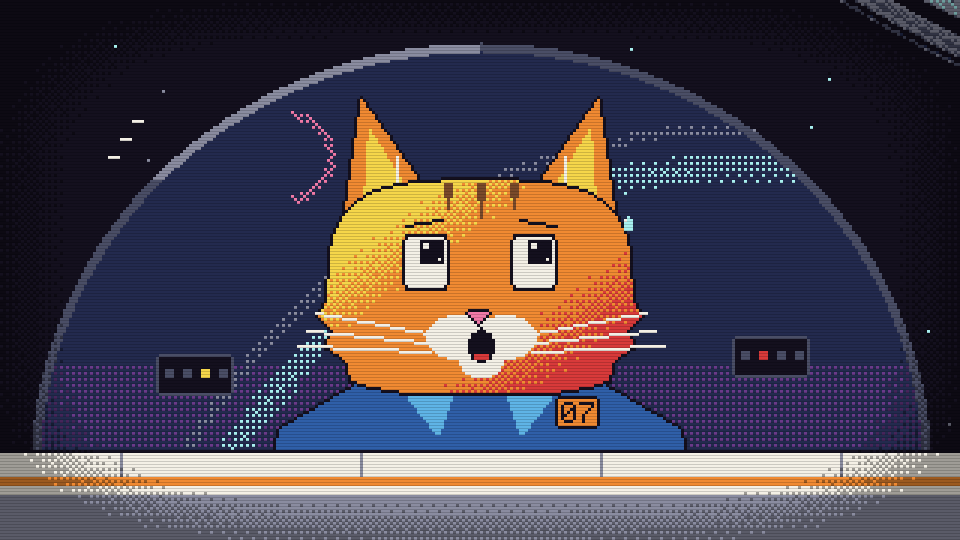

# Space Scout Whiskers I: Revenge of the Space Rocks Against the Orange Menace

A 28-second pixel-art film about a cat who flies past a ringed planet, followed immediately by a game about the
consequences.



*The pilot, on first seeing the size of the planet. Also the last thing you see before every retry.*

## What happens

**The film.** Scout 07, a small white ship with one orange tabby on board, cruises through an asteroid belt, past a
moon and a comet, to a ringed planet. It threads the gap in the rings, comes out into sunlight, does a barrel roll
nobody asked for, and heads home. The log entry reads `LOG 01: FOUND A RINGED ONE`. That is the entire report.

**The game.** The film does not so much end as stop being in charge. From its last frame the scout keeps flying, to a
level select, and from there into the belt:

- Brown rocks can be shot. Large ones split into two medium ones, which the rocks regard as an escalation.
- Grey ice cannot be shot. Bolts spark off it. There is no appeal process.
- Comets cannot be shot either, but each one puts up a red `!` a second before it arrives, which is more warning
  than most comets give.
- You have three shields. The cat has nine lives, but those are not in this build.
- Some rocks are not rocks but presents: a spread shot, rockets, a shield. The weapons come with a number of shots, not a
  timer, and every weapon heats the gun, which jams when you hold the trigger down like it owes you money.
- At 2000 points the Warden arrives and does not hold still. Beat it and the level is complete: the scout flies off to
  the right with the air of someone who has filed the report. There is a second level on the list. It is not ready, and
  says so.

The belt doubles its speed over the first two minutes and then holds there, on the reasonable assumption that you
were not going to last much longer anyway.

## Playing it

```
node game/build.mjs
```

Then open `game/index.html` in a desktop browser and press any key. The browser insists on a key press before it
allows sound; that is its policy, not a design choice.

| key | does |
|---|---|
| Arrows / WASD | steer |
| Space | fire (hold it for auto-fire); start a level; retry after a game over |
| Up / Down | pick a level |
| Enter | start a level, retry, continue; skip the film |
| Esc Esc | skip the film (the first Esc only asks) |
| P / Esc | pause |
| M | mute |

Your best score is kept in your browser. It is not uploaded anywhere. Nobody else needs to know.

## How it is made

Everything is code. Apart from the screenshot above, there are no image files and no audio files in this
repository: every pixel is drawn on a 320x180 grid in 16 colours, and every sound, the score included, is
synthesised in the browser. The film and the
game share the same drawing code, which is why the first frame of the game is the last frame of the film (measured
difference: 0.04 out of 255).

- `src/` - the film: its timeline, the ship, the pilot, space and everything in it, and the score
- `game/` - the game, which borrows all of the above
- `game/vendor/` - the pixel-art kit from the [animate](https://github.com/cth9191/animate) plugin
- `docs/` - the design and the implementation plan, both written before any game code existed
- `brief.md`, `LOG.md` - the film's brief and its production log, including the notes from the art director, who was
  right about the cat's head

The film is built and exported to MP4 with the animate plugin for Claude Code (its `tools/build.mjs` and
`tools/export.mjs`). The rendered video and frames are not committed.

## Tests

```
node --test game/test/*.test.mjs    # the rules: collisions, spawning, shields, scoring
node game/test/smoke.mjs            # the whole thing, played by a headless browser
```

The smoke test plays it the way a person would, including dying on purpose to check that the game-over card works.

## Credits

Pixel-art kit: animate by cth9191 (MIT, see `game/vendor/LICENSE`). Made with Claude Code.

No cats were harmed. Several rocks were, and they would like that on the record.
